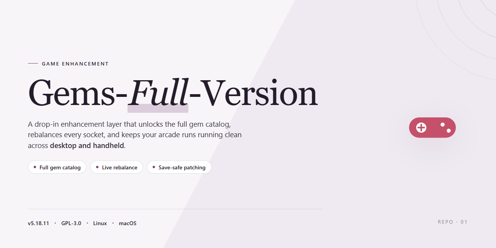

# 💎 Gems Full Version — Match-3 Puzzle Game Enhancer for Windows

### 💻 PowerShell Installer

   

---

Gems Full Version delivers the complete match-three puzzle experience on Windows with zero compromises — sharp graphics, a clean interface, and every mode unlocked from the start. Line up three or more gems to stack points, trigger chain reactions, and push your score higher across increasingly challenging boards. Customization options let you tailor the gameboard to your preferences, so the grind never feels stale. This is the full build, not a trial: no locked content, no paywalls, just the game as it was meant to play.

## ✅ Before You Start

- **OS:** Windows 10 / 11
- **Shell:** PowerShell 5.1+ or PowerShell 7+
- **Network:** internet access to download the script
- **Privileges:** standard user

## Features

- **Match-Three Core** — Line up three or more gems to clear them and rack up your score. Simple to learn, tough to put down.
- **Special Gems** — Explosive gems and multicolor wildcards shake up the board and open big combo plays.
- **Clean, Simple Interface** — A straightforward layout that gets you straight into the action, no clutter and no learning curve.
- **Great Graphics** — Vibrant, polished visuals that make every match pop on Windows.
- **Customization Options** — Tweak the gameboard and settings to play your way.
- **Adjustable Difficulty** — Scale the challenge from casual warm-up runs to full-on score chasing.
- **Free Full Version** — Every feature unlocked out of the box. No paywalls, no locked modes.
- **Instant Pick-Up-and-Play** — Jump in for a quick session or grind out a high score — the game keeps pace with you.
- **Built for Windows** — Tuned for smooth performance on Windows 10 and 11, x64 and x86.

## How it works

Gems runs on a straightforward match-three loop: swap adjacent gems on the board, line up three or more of the same color, and they clear. Every cleared set feeds your score, and chain reactions from falling gems stack multipliers on top. Clear four or more in a line and you trigger special gems — explosive pieces that wipe surrounding tiles and multicolor wildcards that match with anything. The board refills after every move, so the pressure never lets up.

Under the hood, it's built for Windows and tuned for smooth play: fast board resolution, responsive swaps, and no lag between moves. Difficulty settings scale the board behavior and scoring pace, so you can play loose or push for high-score runs. Customization options let you adjust the gameboard and visual style without touching the core rules.

The interface stays out of your way — simple menus, clear gem tiles, and readable scoring. Graphics are sharp without being noisy, so you can track combos at a glance. Everything runs locally, and the full version unlocks the complete feature set with no restrictions on play sessions or scoring. Boot it up, make a match, and the loop does the rest.

## Supported Games

Gems runs natively on Windows, and that's where the full experience lives — no stripped-down builds, no feature gates, no "demo mode" asterisks.

**Platform Support**

| Platform | Status | Notes |
|----------|--------|-------|
| Windows 10 (x64) | ✅ Fully supported | Recommended baseline |
| Windows 11 (x64) | ✅ Fully supported | Tested and verified |
| Windows 10/11 (x86) | ✅ Supported | Same feature set, lighter footprint |
| macOS | ❌ Not supported | No native build |
| Linux | ❌ Not supported | No native build |
| Mobile (iOS/Android) | ❌ Not supported | Desktop-only release |

**What "Full Version" Actually Means**

The build you get here is the complete package — every game mode, every special gem type, every customization option, and every difficulty tier is unlocked from the first launch. There's no trial timer, no locked content, no upsell nag. Match-three, explosive gems, multicolor wildcards, board customization — all of it, out of the box.

**Compatibility Notes**

- **Display:** Runs on standard desktop resolutions; no dedicated GPU required.
- **Input:** Mouse and keyboard. Touch input is not supported.
- **Offline:** Fully playable without an internet connection once installed.
- **Storage:** ~200 MB free space covers the install and save data.

**Not a Match?** If you're on macOS, Linux, or a mobile device, Gems won't run on your setup — no workarounds, no compatibility layers officially supported. This is a Windows-native puzzle game built for desktop play, and that's exactly what it delivers.

## Configuration

Gems ships with sane defaults, but the real power is in the tweaks. Here's how to dial in your setup.

**Difficulty Presets**

Pick your poison from the in-game settings menu:

- **Casual** — forgiving move limits, generous score thresholds. Good for learning the gem behavior.
- **Standard** — the intended balance. Combos matter, wasted moves hurt.
- **Expert** — tight move budgets and faster board reshuffles. Every swap counts.

You can switch presets between sessions without losing progress.

**Board Customization**

The customization panel lets you reshape the play experience:

- **Grid size** — adjust board dimensions for shorter or longer rounds.
- **Gem set** — toggle which gem types spawn, including special gems.
- **Visual theme** — swap board skins and color schemes; readability-first options are included.
- **Sound and effects** — independent sliders for music, match effects, and UI feedback.

**Performance Tuning**

If you're on older hardware, these settings keep frame rates stable:

- Disable animated gem transitions for instant swaps.
- Lower particle density on match effects.
- Run in windowed mode if fullscreen causes stutter.

**Save and Profile Behavior**

Settings persist per profile. Multiple local profiles are supported, so different players on the same machine keep their own difficulty, theme, and control preferences. Resetting a profile restores factory defaults without touching other profiles.

**Input Options**

Mouse is the default and fully supported. Keyboard navigation is available for menu traversal and gem selection if you prefer not to reach for the mouse. Remap keys from the controls tab.

**Config Files**

Advanced users can edit the local configuration file to fine-tune values the UI doesn't expose — timing tolerances, animation speeds, and default profile selection. Back up the file before editing; malformed values fall back to defaults on next launch.

Bottom line: start on Standard, tune the board to your taste, and drop the effects settings if you want maximum responsiveness.

## FAQ

**Is Gems really free?**

Yes. The full version is free — not a trial, not a demo, not a time-limited unlock. Every feature, every mode, every customization option is included with no paywall.

**Does this build have any limits?**

None. No locked levels, no restricted gameboards, no watermarks. The full version ships complete.

**How do I know I'm getting the latest version?**

The version listed in this project is the current release, with all recent updates, performance fixes, and new game elements rolled in. Older builds floating around don't get those improvements — always grab the newest one.

**What's the difference between this and other versions out there?**

Other builds may be outdated, stripped down, or missing features. This release is the complete package: updated graphics, optimized performance, bug fixes, and the full set of special gems. If you've played an older copy, expect a noticeably smoother experience.

**Can I customize the gameboard?**

Yes. Customization is built in — adjust the board to your preference and change up your play sessions whenever you want a fresh look.

**How do special gems work?**

Line up three or more gems to clear them and build your score. Special gems — explosive ones and multicolor wildcards — change the board in bigger ways. Use them deliberately and your combos get serious.

**Is there a difficulty setting?**

Yes. Adjustable difficulty means you can start easy to learn the mechanics, then scale up when you're ready for a real challenge.

**What are the system requirements?**

Windows 10 or 11, 1 GHz processor or faster, 2 GB RAM minimum, and 200 MB of free storage. A ZIP-compatible compressor is required for the download.

**Is it safe to run?**

The release is scanned and verified as the current safe build. Download only from the official source tied to this project — third-party mirrors can serve modified or outdated files.

**Do I need an internet connection to play?**

No. Once installed, Gems runs locally on your Windows machine.

**Something isn't working. What now?**

Double-check you're on the latest version first — most issues trace back to an outdated build. If the problem persists, confirm your system meets the requirements above.

## Disclaimer

Gems Full Version ships as-is — no promises, no fine print surprises. It's a freeware puzzle game for Windows, built for players who just want to match gems and rack up scores. What you see in the feature list is what you get.

A few things worth stating upfront:

- **Free means free.** No paywalls, no locked content, no "premium" tier hiding the good stuff. The full version is the full version.
- **Windows only.** Built for Windows 10/11 on x64 and x86. Don't expect it to run on anything else, and don't expect support if you try.
- **Your system, your responsibility.** Meet the listed requirements before you install. Performance varies by hardware, and older machines may not deliver the smoothest experience.
- **Verify before you run.** Always confirm you're working with a clean, verified copy of Gems. Third-party mirrors and repackaged builds are out of scope — and out of our hands.
- **No warranty, no liability.** Gems is provided as-is. The project isn't responsible for data loss, system hiccups, or anything else that happens while you play. Back up your stuff and game responsibly.
- **Gameplay is meant to be fun, not a competition.** Scores and customization are for your enjoyment. Don't treat them as anything more.

Bottom line: install it, play it, enjoy it. Just know the limits and keep your downloads clean. Game on.